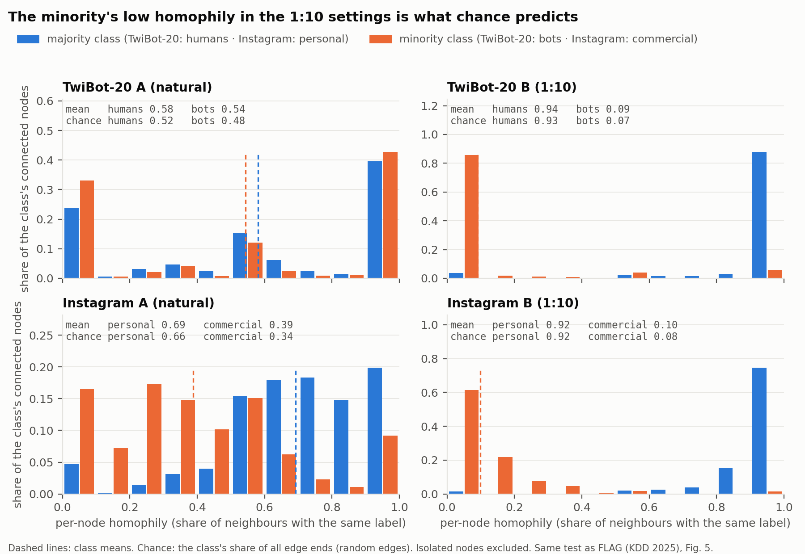

# Progress Report

A living report, updated as experiments finish. The newest entries are at the top of each
section. For how everything works, see [TEAM_GUIDE.md](TEAM_GUIDE.md).

**Last updated:** 3 November 2026, 20:15

**Scope.** TwiBot-20 is the main dataset: steps 1–6, settings A and B. Instagram is the secondary dataset, steps 1–5 only: it checks whether the step 1–5 findings hold on a second, multilingual graph. Step 6 is not planned for Instagram. One step 6 run takes about 3–6 h on our Mac, so that time goes to the main dataset.

## Status

| Experiment | TwiBot-20 A | TwiBot-20 B | Instagram A | Instagram B |
|---|---|---|---|---|
| Step 1: homophily | ✅ | ✅ | ✅ | ✅ |
| Step 2: baselines | ✅ | ✅ | ✅ | ✅ |
| Step 3: encoders | ✅ 7 encoders | ✅ 7 encoders | ✅ 3 encoders | ✅ 3 encoders |
| Step 4: MLP / GCN / SAGE / FAGCN | ✅ + bridge graph | ✅ | ✅ | ✅ |
| Step 5: zero-shot reasoner | ✅ | ✅ | ✅ | ✅ |
| Step 6: DGP (LoRA), dgp | ✅ 1 seed | ✅ 1 seed | not in scope | not in scope |
| Step 6: DGP (LoRA), target | ✅ 1 seed | ✅ 1 seed | not in scope | not in scope |
| FLAG-lite and LINKX baselines (step 4) | ✅ | ✅ | ✅ | ✅ |

✅ done · 🔄 running · ⏳ to do

**Current run (GPU, from 4 Nov 04:26):** step 6 LoRA seeds 1 and 2 for `dgp` and `target` on TwiBot-20 A (`LORA_SEED`), each rescored right after; about 11 h in total. CPU alongside: the semi-synthetic heterophily sweep.
- Done today: step 6 `target` on TwiBot-20 A (13:30–15:42); Qwen3-1.7B embeddings (15:42–19:14, 3.5 h).
- On CPU after the chain: the setting B training-size control and bootstrap.

## Data preparation

### Sources and labels
- **TwiBot-20** (Feng et al., CIKM 2021), the TwiBot-22-format release (`TwiBot-20-Format22.zip`), read straight from the zip by `my_build/prep_twibot20.py`. Class 1 = bot. We keep the **11,826 labelled users** and drop the 217,754 unlabelled support users (see "dropped support users").
- **Instagram**, the GLBench version (Li et al., 2024) that FLAG also uses, already prepared as `x_text`, `y` and `edge_index` files; we did not rebuild it. Class 1 = commercial account (business, brand or media), a stand-in for a minority class, not fraud.

### Text per user
- **TwiBot-20:** the bio plus the user's first 20 tweets, one per line (whitespace trimmed, line breaks inside a tweet removed), cut at 2,000 characters. **61.6% of users reach that cap**, so the models see the bio and as many tweets as fit. 12.9% of users have no bio, 1.3% have no tweets, 37 have no text at all.
- **Instagram:** the bio (median 119 characters, maximum 523); 99 users have none.
- **Profile metadata is excluded.** TwiBot-20's "verified" flag alone gives macro-F1 0.803: a collection shortcut (Hays et al., WWW 2023), not text or graph signal.

### Edges
- **TwiBot-20:** friend and follow links between labelled users, stored both ways (undirected), merged into one edge type for steps 4–5; step 6 keeps the two types. 16,349 undirected edges; no self-loops or duplicates.
- **Instagram:** 72,005 undirected follow edges; no self-loops or duplicates.

### Splits and the two settings
| | Users | Class 1 | Edges | Train / val / test |
|---|---|---|---|---|
| TwiBot-20 A (natural) | 11,826 | 6,589 bots (55.7%) | 16,349 | 8,278 / 2,365 / 1,183 (official split) |
| TwiBot-20 B (1:10) | 5,761 | 524 bots | 5,274 | 4,000 / 1,164 / 597 |
| Instagram A (natural) | 11,339 | 4,115 commercial (36.3%) | 72,005 | 6,803 / 2,268 / 2,268 (stratified 60/20/20, seed 42) |
| Instagram B (1:10) | 7,946 | 722 commercial | 38,193 | 4,767 / 1,589 / 1,590 |

**Setting B** keeps every class-0 user and a random sample of class-1 users (seed 42) so that class 1 is 10% of class 0, following FLAG's protocol (§4.1.1), with only the edges whose two ends are kept. Splits are restricted to the kept users. The subsampling removes almost all bot–bot edges on TwiBot-20 (54 rows vs 8,162 in A).

### Encoding (step 3)
TwiBot-20 text is longer than an encoder reads, so each piece (the bio and each tweet) is encoded separately, up to 128 tokens, and the L2-normalised piece vectors are averaged per user. Decoder LLMs (Qwen2.5-1.5B, Qwen3-1.7B) and Twitter-RoBERTa are mean-pooled over tokens. A user with no text gets a zero vector, and two 0/1 flags ("no bio", "no tweets") are added for TwiBot-20, so nobody is dropped. Features are standardised with training-set statistics only.

### Profile metadata: which fields are shortcuts? (TwiBot-20 A, full test set)

We use every profile field unless it is a shortcut, under a rule fixed before looking at results (`my_build/metadata_check.py`): a field is excluded if (a) it is a documented collection or labelling artefact, or (b) one split on it labels a large group almost perfectly (a depth-1 tree leaf with at least 10% of training users that is at least 99% one class).

| Field | Single-field depth-1 tree: macro-F1 / AUROC | Purest large leaf (share of users, purity) | Spearman with in-friend count | Verdict |
|---|---|---|---|---|
| verified | 0.803 / 0.800 | – | – | **shortcut**: documented (Hays et al., WWW 2023, §4.1) |
| followers count | 0.731 / 0.731 | 31.7%, 77.0% | +0.59 | allowed |
| following count | 0.456 / 0.534 | 16.9%, 68.8% | −0.03 | allowed |
| tweet count | 0.594 / 0.597 | 49.9%, 65.8% | +0.38 | allowed |
| listed count | 0.714 / 0.716 | 27.0%, 81.6% | +0.59 | allowed |
| account age | 0.620 / 0.621 | 52.6%, 66.5% | +0.33 | allowed |

| Qwen2.5-1.5B embeddings + | LR macro-F1 (AUROC) | MLP macro-F1 (AUROC), 3 seeds | Gain over text only (paired bootstrap) |
|---|---|---|---|
| nothing (text only) | 0.756 (0.822) | 0.766 (0.840) | – |
| **the 5 allowed fields** | **0.804 (0.874)** | **0.806 (0.885)** | LR +0.048 [+0.027, +0.067]; MLP +0.040 [+0.024, +0.056] |
| all 6 fields incl. verified (reference only) | 0.861 (0.926) | 0.844 (0.921) | +0.10 |
| the 5 allowed fields alone (no text) | 0.748 (0.769) | 0.742 (0.796) | – |

The allowed fields add a real +0.04–0.05 to text. Two caveats: followers and listed count correlate ρ 0.59 with the crawl artefact (in-friend count), so part of their gain is the same collection effect; and every comparison elsewhere in this report (encoders, GNNs, LLMs) is text-only, so these rows are a separate "text + profile" track, not a replacement. The DGP numerical-summary variant (`VARIANT=dgp_num`) uses only the 5 allowed fields.

### Checks on the prepared data
| Check | Result |
|---|---|
| Graph: self-loops, duplicate edges, symmetry | none, none, symmetric (both datasets) |
| Duplicate text across splits (`duplicate_text.py`) | 1 of 1,183 TwiBot-20 test users and 12 of 2,268 Instagram test users share a training user's normalised text; dropping them changes Qwen2.5 + LR by ≤ 0.001 |
| Raw vs cleaned text (`clean_text_check.py`, TF-IDF + LR) | URLs → `URL`, @mentions → `@USER`, retweet prefixes removed: −0.007 to +0.002 macro-F1; deleting URLs and mentions: −0.007 to −0.026. Every CI includes 0, so cleaning would not have helped, and removing URLs and mentions slightly hurts (they carry signal: 93.8% of TwiBot-20 users post URLs, 33.4% of tweets are retweets) |
| Language | 2.8% of TwiBot-20 and 5.6% of Instagram users write mostly non-Latin text; kept, and the multilingual encoder covers it |

## Latest results (macro-F1, test set)

**Which test set?** Each heading says so. Most tables use the **full test set**: TwiBot-20 1,183 users (A) and 597 (B); Instagram 2,268 (A) and 1,590 (B). One table, "LLM reasoner vs trained models", uses the smaller **step 5 test sample**, because LLM scoring is slow. Its trained rows are also a single seed, so the same model can show a slightly different number there (for example, Qwen2.5 + GCN is 0.707 in the ladder and 0.698 there).

### TwiBot-20, encoder ladder (full test set, mean of 3 seeds)

| Encoder | A: MLP | A: GCN | A: SAGE | A: FAGCN | B: MLP | B: GCN | B: SAGE | B: FAGCN |
|---|---|---|---|---|---|---|---|---|
| MiniLM | 0.726 | 0.686 | 0.721 | 0.722 | 0.588 | 0.550 | 0.565 | 0.584 |
| E5-base (English) | 0.760 | 0.700 | 0.740 | 0.733 | 0.564 | 0.589 | 0.567 | 0.542 |
| Twitter-RoBERTa | 0.749 | 0.692 | 0.743 | 0.722 | 0.612 | 0.579 | 0.609 | 0.571 |
| multilingual-E5 | 0.747 | 0.699 | 0.741 | 0.726 | 0.606 | 0.585 | 0.589 | 0.567 |
| Qwen3-Embedding | 0.727 | 0.691 | 0.707 | 0.710 | 0.599 | 0.574 | 0.558 | 0.579 |
| Qwen2.5-1.5B | 0.766 | 0.707 | 0.750 | 0.744 | 0.613 | 0.577 | **0.624** | 0.554 |
| Qwen3-1.7B (the step 6 LLM) | **0.769** | 0.706 | 0.750 | 0.740 | 0.593 | 0.581 | 0.579 | 0.570 |
| Graph only | – | 0.577 | 0.568 | 0.562 | – | 0.497 | 0.497 | 0.492 |

FAGCN (Bo et al., AAAI 2021; PyG `FAConv`, eps 0.3) is built for heterophily: each edge gets a learned weight in [−1, 1], so a neighbour can be subtracted as well as added. It has two propagation layers between an input and an output linear layer, the same hidden size (128) and about the same parameter count as GCN (197k). It also uses the same learning rate, weight decay, early stopping and seeds. Its own settings (eps 0.3, dropout 0.5) are fixed, not tuned, like every GNN here. In setting B (1:10), FAGCN is below MLP for every encoder (by 0.004–0.058), and its seeds vary more (std up to 0.02).

References for TwiBot-20 A: TF-IDF 0.702; metadata without "verified" 0.755 (not a valid model).

### Heterophily and fraud baselines: FLAG-lite and LINKX (full test set, mean of 3 seeds)

Two more graph baselines, run with the same training, seeds and validation cut-off rule as step 4 (`my_build/step4_gnn.py`):
- **FLAG-lite**: FLAG (Yang et al., KDD 2025) without its LLM. Its skip-GNN, `GCN(X, A) + Linear(X)` (eq. 6), on a graph pruned by its semantic-similarity sampling: each user keeps up to its 10 most text-similar neighbours with cosine > 0 (`GRAPH=similar10`, 1-hop). FLAG's own ablation (Table 5) credits these two parts with most of its gain. The pruning drops about 25% of TwiBot-20's edges and 48% of Instagram's.
- **LINKX** (Lim et al., NeurIPS 2021; PyG `LINKX`): a non-homophilous baseline that never averages neighbours. One MLP reads each user's adjacency row, one its features, and a third combines them.

| Encoder + model | TwiBot-20 A | TwiBot-20 B | Instagram A | Instagram B |
|---|---|---|---|---|
| Qwen2.5 + MLP (no edges) | **0.766** | 0.613 | 0.607 | **0.575** |
| Qwen2.5 + GCN | 0.707 | 0.577 | **0.609** | 0.549 |
| Qwen2.5 + skip-GCN | 0.752 | 0.612 | 0.604 | 0.558 |
| Qwen2.5 + GCN, similar-10 graph | 0.719 | 0.585 | 0.607 | 0.562 |
| Qwen2.5 + FLAG-lite (skip-GCN, similar-10) | 0.754 | **0.615** | 0.602 | 0.568 |
| Qwen2.5 + LINKX | 0.752 | 0.607 | 0.598 | 0.562 |
| multilingual-E5 + MLP | **0.747** | 0.606 | 0.605 | 0.561 |
| multilingual-E5 + FLAG-lite | 0.731 | **0.635** | **0.613** | **0.565** |
| multilingual-E5 + LINKX | 0.730 | 0.615 | 0.602 | 0.557 |
| Graph only: GCN / skip-GCN / LINKX | 0.577 / 0.578 / **0.595** | 0.497 / 0.497 / 0.488 | 0.548 / 0.547 / 0.532 | 0.500 / 0.498 / 0.521 |

- **The skip connection does most of the work.** It lifts GCN from 0.707 to 0.752 on TwiBot-20 A, the same "keep your own features" effect as SAGE and FAGCN. Similarity pruning adds about 0.01 to GCN.
- **On TwiBot-20 A neither FLAG-lite (0.754) nor LINKX (0.752) beats MLP (0.766)**, matching every other GNN here. Setting B's best (multilingual-E5 + FLAG-lite 0.635 ± 0.018 vs MLP 0.606) is inside B's ±0.05 noise.
- **LINKX graph-only (0.595) beats GCN graph-only (0.577) in A**: reading who links to whom helps more than averaging. It is still far below the untrained in/out link-direction score (AUROC 0.713 vs LINKX's 0.633), because our adjacency is undirected.

### Instagram (secondary dataset, steps 1–5): full test set; LR one fit, MLP and GNNs mean of 3 seeds

On Instagram, class 1 is **commercial accounts** (business, brand or media) against personal ones: a stand-in for a minority class, not fraud. FLAG uses the same Instagram graph (from GLBench, Li et al. 2024) as a fraud proxy at 1:10, our setting B. Its reported macro-F1 there is 0.473–0.483 for text-embedding GNNs and at most 0.507 for FLAG itself (Table 4), near the 0.476 an all-majority predictor scores; our Qwen2.5 + LR reaches 0.578 in B. Splits, subsample and encoder differ (FLAG uses Sentence-BERT), so this is not a head-to-head comparison. Text alone is much weaker here than on TwiBot-20 (AUROC about 0.63 against 0.84).

| Encoder | A: LR | A: MLP | A: GCN | A: SAGE | A: FAGCN | B: LR | B: MLP | B: GCN | B: SAGE | B: FAGCN |
|---|---|---|---|---|---|---|---|---|---|---|
| MiniLM | 0.588 | 0.585 | 0.607 | 0.588 | 0.596 | 0.546 | 0.536 | 0.552 | 0.543 | 0.566 |
| multilingual-E5 | **0.612** | 0.605 | 0.606 | 0.602 | **0.613** | 0.563 | 0.561 | 0.555 | 0.572 | 0.560 |
| Qwen2.5-1.5B | 0.608 | 0.607 | 0.609 | 0.604 | 0.606 | **0.578** | 0.575 | 0.549 | 0.562 | 0.534 |
| Graph only | – | – | 0.548 | 0.544 | 0.522 | – | – | 0.500 | 0.498 | 0.494 |

References: TF-IDF (balanced) 0.578 (A), 0.552 (B). Every model sits within about 0.03 of LR. Unlike TwiBot-20, GCN is level with or above MLP for all three encoders in setting A (macro-F1 +0.001 to +0.022; AUROC 0.639–0.642 vs 0.609–0.635), and graph-only reaches 0.548. In B no graph model is consistently better or worse.

### LLM reasoner vs trained models (step 5 test sample, 1 seed)

**Sample sizes:** 400 test users for TwiBot-20 A, 300 for Instagram A and 600 for Instagram B, stratified, the same users for every row in a column. For TwiBot-20 B the "sample" is the whole test set (597). The trained rows here are one run (seed 0), not the mean of 3 seeds used elsewhere.

Two different LLMs appear here. **Step 5 uses Qwen2.5-1.5B-Instruct** (zero-shot only). **Step 6 uses Qwen3-1.7B**, the same family as the DGP paper's Qwen3-8B, both zero-shot and fine-tuned with LoRA. The trained baselines use Qwen2.5-1.5B *embeddings* (step 3) with LR or GCN on top. Every row is scored on the same step 5 test sample.

| Step | Model | TwiBot-20 A | TwiBot-20 B | Instagram A | Instagram B |
|---|---|---|---|---|---|
| 3–4 | Qwen2.5-1.5B embeddings + LR (trained) | **0.749** | **0.633** | 0.607 | 0.546 |
| 3–4 | Qwen2.5-1.5B embeddings + GCN (trained) | 0.698 | 0.573 | **0.623** | **0.562** |
| 5 | Qwen2.5-1.5B-Instruct zero-shot: target only | 0.584 | 0.541 | 0.553 | 0.522 |
| 5 | Qwen2.5-1.5B-Instruct zero-shot: raw neighbours | 0.591 | 0.547 | 0.552 | 0.499 |
| 5 | Qwen2.5-1.5B-Instruct zero-shot: DGP summaries | 0.550 | 0.541 | 0.537 | 0.538 |
| 6 | Qwen3-1.7B zero-shot: target only | 0.590 | 0.503 | not in scope | not in scope |
| 6 | Qwen3-1.7B zero-shot: DGP summaries | 0.562 | 0.527 | not in scope | not in scope |
| 6 | Qwen3-1.7B LoRA: target only | 0.694 | 0.618 | not in scope | not in scope |
| 6 | Qwen3-1.7B LoRA: DGP summaries | 0.726 | 0.628 | not in scope | not in scope |

**TwiBot-20 B, step 6 `dgp`** (597 test users, 54 bots; the step 5 "sample" is the whole test set; 1 seed): LoRA + DGP scores macro-F1 0.628, AUROC 0.723, PR-AUC 0.296, against Qwen2.5 + LR 0.634 / 0.799 / 0.282 and MLP 0.613 / 0.788 / 0.269 (mean of 3 seeds; the seed-0 run in the step 5 table is 0.633). Paired bootstrap against that 3-seed MLP on all 4,000 training users (`B/bootstrap_ci.json`): macro-F1 +0.015 [−0.051, +0.081], AUROC −0.064 [−0.124, −0.008], PR-AUC +0.027 [−0.080, +0.143]. So in B LoRA is level on macro-F1 and PR-AUC (CIs about ±0.07–0.11 wide) and significantly lower on AUROC. With 54 test bots, B's apparent PR-AUC lead is noise.

**TwiBot-20 B, step 6 `target`**: LoRA on the user's own text scores 0.618 / AUROC 0.683 / PR-AUC 0.188 (zero-shot 0.503), so `dgp` − `target` is +0.010 macro-F1, +0.040 AUROC, +0.108 PR-AUC (paired bootstrap queued). Unlike A, the link-type cue does not account for it: target LoRA + 3 link flags (LR fitted on validation) scores only 0.574 (AUROC 0.687), −0.054 [−0.102, −0.006] below `dgp`, and `dgp` ranks better than `target` within most flag groups (no follow link: AUROC 0.702 vs 0.611; no friend link: 0.718 vs 0.681; has follow link is the exception, 0.770 vs 0.814). So in B the summaries seem to add something beyond "which links exist", but B's edges are themselves label-dependent and its CIs are wide. Validation loss and AUROC agreed in B (best check at epoch 2.0: loss 0.335, AUROC 0.810), unlike A.

**Sample noise.** On 400 users, macro-F1 moves by about ±0.04 from test-set noise alone, and the sample shifts models in different directions against the full test set: LoRA + DGP 0.711 → 0.726, LoRA target 0.704 → 0.694, LR 0.756 → 0.749. So on the sample dgp − target is +0.032; on the full test set it is +0.007. Use the full-test numbers (training-size and bootstrap sections) for any LoRA claim.

**Validation samples.** LLM scoring is slow, so the zero-shot rows (steps 5 and 6) pick their cut-off on a stratified validation *sample*: 200 users for TwiBot-20 A, 400 for B, 150 for Instagram A and 300 for Instagram B. The trained models pick theirs on the full validation set. The step 6 LoRA runs use that same sample for early stopping, then pick their cut-off on the full validation set (2,365 users for TwiBot-20 A).

The two "zero-shot: DGP summaries" rows (0.550 and 0.562) differ in the LLM and in how the summaries were made. Step 5 used its own summaries; step 6 used the paper's diffusion trimming and 10-token summaries. So they are not a like-for-like comparison of the two LLMs.

LoRA dgp is one seed (42). On the full TwiBot-20 A test set (1,183 users) it scores 0.711 macro-F1, AUROC 0.794. Every model picks its own cut-off by the same rule: the one that maximises macro-F1 on validation, applied unchanged to test. On the 400-user step 5 sample its AUROC (0.828) is the highest, but that does not hold on the full test set: AUROC 0.794, against 0.822 for Qwen2.5 + LR and 0.840 for MLP. So it is behind on ranking too, not just on the cut-off. Even the best cut-off chosen on test itself (not a valid model) gives only 0.726.

### LoRA checkpoint rule: both adapters (full test set, 1 seed)

`my_build/step6_rescore.py` scores each run's last-check adapter and applies the text-only models' rule, written into the script before any last-adapter test score existed (commit `fc45a63`, 3 Nov 15:24): keep the adapter with the higher full-validation macro-F1. Only two adapters per run were saved and compared.

| Run | Lowest val loss: epoch, test macro-F1 / AUROC | Last check: epoch, test macro-F1 / AUROC | Full-val macro-F1 (lowest loss / last) | Kept by the rule |
|---|---|---|---|---|
| A `dgp` | 1: 0.711 / 0.794 | 2: **0.727** / 0.815 | 0.718 / 0.743 | last |
| A `target` | 1: 0.704 / 0.782 | 2: **0.728** / 0.812 | 0.718 / 0.737 | last |
| B `dgp` | 2: **0.628** / 0.723 | 3: 0.502 / 0.546 (collapsed) | 0.648 / 0.538 | lowest loss |
| B `target` | 1: 0.618 / 0.683 | 2: **0.644** / 0.739 | 0.638 / 0.644 | last |

**Under this rule the DGP summaries add nothing:** `dgp` − `target` is −0.001 in A (0.727 vs 0.728) and −0.016 in B (0.628 vs 0.644). LoRA on 1,300 users is then level with text-only models on the same 1,300 users (MLP 0.726 on the same draw). **The tables and findings below still use the lowest-validation-loss adapters** until the team decides which rule is primary; CIs for the rule's adapters (`LORA_ADAPTER=chosen` in `bootstrap_ci.py` and `link_direction.py`) are running.

### Where GCN loses: connected vs isolated test users (TwiBot-20 A, full test set, mean of 3 seeds)

| Qwen2.5-1.5B + | Connected (1,096 users) | Isolated (87 users) |
|---|---|---|
| MLP | **0.767** | 0.743 |
| GCN | 0.701 | 0.777 |
| SAGE | 0.752 | 0.734 |
| FAGCN | 0.742 | 0.770 |

GCN's whole loss is on connected users, where neighbours are averaged in. The isolated column is only 87 users (47 bots) and is not reliable: isolated users have no neighbours in either graph, yet GCN scores 0.777 on them when trained on the real edges and 0.720–0.758 (mean 0.738) when trained on five shuffled versions. The difference comes only from weights learned on a different graph.

### How much label signal do the edges carry? (all graphs)

Plain edge homophily is misleading when classes are unbalanced, so this table also gives two measures from Platonov et al. ([arXiv 2209.06177](https://arxiv.org/abs/2209.06177)) that correct for chance. **Adjusted homophily** is 0 when edges join same-label users no more often than chance. **Label informativeness** (0 to 1) says how much a neighbour's label tells you about yours. Both use all labels, test included: they describe the data and are never a model input. From `my_build/graph_stats.py` (`results/graph_stats.json`).

| Graph | Edges | Edge homophily | Chance level | Adjusted homophily | Label informativeness |
|---|---|---|---|---|---|
| TwiBot-20 A, all edges | 16,349 | 0.532 | 0.501 | 0.062 | 0.003 |
| TwiBot-20 A, friend only | 11,819 | 0.508 | 0.515 | −0.015 | 0.000 |
| TwiBot-20 A, follow only | 4,922 | 0.591 | 0.554 | 0.081 | 0.005 |
| TwiBot-20 A, + bridge edges | 46,362 | 0.588 | 0.501 | 0.175 | 0.022 |
| TwiBot-20 B, all edges | 5,274 | 0.879 | 0.878 | 0.014 | 0.000 |
| Instagram A, all edges | 72,005 | 0.586 | 0.551 | 0.078 | 0.005 |
| Instagram B, all edges | 38,193 | 0.861 | 0.856 | 0.033 | 0.002 |

Every graph sits near zero once chance is removed. Setting B's high edge homophily (0.86–0.88) only reflects the 1:10 ratio: almost every edge touches the large class. On TwiBot-20, B's near-zero value is also caused by how B is built: it keeps 8% of bots and only edges whose two ends are both kept, so bot–bot edge rows fall from 8,162 (A) to 54 (B). A bot's neighbours are then 7.8% bots, below B's 9.1% base rate, and isolation becomes tied to the label (41.8% of B's bots are isolated, against 27.6% of its humans; 7.3% vs 8.5% in A). Friend links on TwiBot-20 join same-label users no more often than chance (adjusted −0.015); the label signal in TwiBot-20's links sits elsewhere, in who lists whom (see "who lists whom"). The bridge edges raise adjusted homophily to 0.175, yet GCN still gets worse on them (robustness check below).

### Per-class homophily: is there "camouflage"? (FLAG's Figure 5 test)

FLAG (KDD 2025, Fig. 5) argues its 1:10 fraud datasets show *neighbourhood camouflage*: minority nodes have low per-node homophily, majority nodes high. We ran the same histogram on our four graphs, adding the chance level (each class's share of all edge ends, which is what random edges would give). `my_build/class_homophily.py`, figure `my_build/figures/class_homophily.png`.

| Graph | Minority: mean homophily | Minority: chance | Majority: mean | Majority: chance |
|---|---|---|---|---|
| TwiBot-20 A | 0.543 | 0.484 | 0.581 | 0.516 |
| TwiBot-20 B (1:10) | 0.091 | 0.065 | 0.935 | 0.935 |
| Instagram A | 0.389 | 0.341 | 0.692 | 0.659 |
| Instagram B (1:10) | 0.099 | 0.078 | 0.921 | 0.922 |

Every class sits a few points above chance. The low-minority / high-majority pattern FLAG reads as camouflage appears in both 1:10 settings, but it is almost exactly what chance predicts once one class is 10 times the other; it comes from the imbalance, not from the minority hiding among the majority. On TwiBot-20 A there is no camouflage at all (bots 0.54 vs humans 0.58).

### TwiBot-20 graph: dropped support users

Our TwiBot-20 graph keeps only the 11,826 labelled users. The benchmark also ships 217,754 unlabelled support users, and its own GCN/GAT code keeps them as neighbours. `my_build/playground_bridges.py` counts what we lost (`results/twibot20/support_bridges.json`).

- 8,082 support users (3.7%) are **bridges**: linked to 2 or more labelled users. 171,896 (79%) link to exactly one, so they connect nothing. The largest hub has only 25 labelled neighbours.
- 786 of our 923 isolated users sit next to a bridge (75 of the 87 isolated test users).

| Graph | Edges | Edge homophily |
|---|---|---|
| Random-edge baseline | – | 0.507 |
| Ours (labelled only) | 16,349 | 0.532 |
| Bridge edges only (labelled–support–labelled, collapsed) | 30,240 | 0.619 |
| Ours + bridge edges | 46,362 | 0.588 |

Homophily here uses all labels, test included: it describes the data and is never a model input. The published TwiBot-20 GCN/GAT scores (F1 0.809 / 0.853) are binary F1 with profile metadata, so they are not comparable with our text-only macro-F1.

### Control: training-set size (TwiBot-20 A)

Step 6 fine-tunes on **1,300** training users (the DGP paper's size); the text-only models above train on all **8,278**. `my_build/control_train_size.py` retrains Qwen2.5-1.5B + LR / MLP on the exact 1,300 users step 6 used. Validation, cut-off and test sets are unchanged. MLP is the mean of 3 seeds.

| Model | Training users | Full test set: macro-F1 | Full test set: AUROC | Step 5 sample: macro-F1 |
|---|---|---|---|---|
| Qwen2.5-1.5B + MLP | 8,278 | 0.766 | 0.840 | 0.754 |
| Qwen2.5-1.5B + LR | 8,278 | 0.756 | 0.822 | 0.749 |
| Qwen2.5-1.5B + MLP | 1,300 | 0.726 | 0.796 | 0.723 |
| Qwen2.5-1.5B + LR | 1,300 | 0.725 | 0.786 | 0.712 |
| Qwen3-1.7B + MLP (same model as LoRA, used as an encoder) | 8,278 | **0.769** | **0.840** | 0.759 |
| Qwen3-1.7B + LR | 8,278 | 0.765 | 0.826 | 0.759 |
| Qwen3-1.7B + MLP | 1,300 | 0.724 | 0.792 | 0.729 |
| Qwen3-1.7B + LR | 1,300 | 0.717 | 0.795 | 0.713 |
| Qwen3-1.7B LoRA + DGP summaries (1 seed) | 1,300 | 0.711 | 0.794 | 0.726 |
| Qwen3-1.7B LoRA, target text only (1 seed) | 1,300 | 0.704 | 0.782 | 0.694 |

**Same model, two roles.** Qwen3-1.7B used as a frozen encoder with an MLP scores 0.724 on 1,300 users and 0.769 on all users; fine-tuned with LoRA on the same 1,300 users it scores 0.711 (DGP summaries) and 0.704 (target text). So the model version does not explain the gap: in setting A, Qwen2.5 and Qwen3 behave alike as encoders (in B, Qwen3 is lower: LR 0.584 vs 0.634). With the same 1,300 users, the text-only models lose about 0.03–0.04, and the gap to LoRA + DGP shrinks from 0.055 to 0.015 on the full test set. On the step 5 sample LoRA is level with them. The full-train rows reproduce steps 3 and 4 exactly, which checks the setup.

**Which 1,300 users?** The table uses the same draw as step 6. Over 6 random stratified 1,300-user draws (`control_train_size.py`, `DRAWS=6`), LR scores 0.730 ± 0.005 and MLP 0.733 ± 0.006 on the full test set (MLP: 3 seeds per draw). The step 6 draw is the lowest of the six (LR 0.725, MLP 0.726), so the typical gap between LoRA + DGP (0.711) and a text-only model on 1,300 users is about 0.02, not 0.014. LoRA itself was trained on one draw only.

**Learning curve** (Qwen2.5-1.5B embeddings, full test set, MLP mean of 3 seeds; `my_build/bootstrap_ci.py`):

| Training users | 325 | 650 | 1,300 | 2,600 | 5,200 | 8,278 |
|---|---|---|---|---|---|---|
| LR | 0.714 | 0.720 | 0.725 | 0.743 | 0.754 | 0.756 |
| MLP | 0.697 | 0.713 | 0.726 | 0.751 | 0.754 | 0.766 |

LoRA + DGP at 1,300 users (0.711) is below every text-only point from 650 users up, and level with LR trained on 325 users (0.714), a quarter of its data. LoRA target only (0.704) is below them all. Equal training data closes most of the gap, but not all of it.

### Are the gaps real? Paired bootstrap 95% CIs (TwiBot-20 A, full test set)

Each pair is scored on the same 2,000 resamples of the 1,183 test users; seeded models count as the mean of their 3 seeds. A CI that excludes 0 means the gap is larger than test-set noise. LoRA is one seed, so its CI covers test-set noise only, not seed noise.

| Comparison (Qwen2.5-1.5B embeddings unless LoRA) | Difference | 95% CI | Excludes 0? |
|---|---|---|---|
| GCN − MLP (all train) | −0.059 | [−0.082, −0.037] | yes |
| FAGCN − MLP (all train) | −0.021 | [−0.039, −0.004] | yes |
| SAGE − MLP (all train) | −0.015 | [−0.031, +0.000] | no (borderline) |
| FAGCN − GCN (all train) | +0.038 | [+0.022, +0.055] | yes |
| MLP: 1,300 − all train | −0.040 | [−0.055, −0.023] | yes |
| LoRA + DGP − MLP (both 1,300) | −0.014 | [−0.041, +0.013] | no |
| LoRA + DGP − LR (both 1,300) | −0.014 | [−0.042, +0.016] | no |
| LoRA + DGP (1,300) − MLP (all train) | −0.054 | [−0.080, −0.027] | yes |
| LoRA target only − MLP (both 1,300) | −0.022 | [−0.047, +0.003] | no |
| LoRA + DGP − LoRA target only | +0.007 | [−0.015, +0.030] | no |

Same test on **Instagram A** (Qwen2.5-1.5B embeddings, 2,268 test users; `results/A/bootstrap_ci.json`): GCN − MLP +0.002 [−0.016, +0.020], SAGE − MLP −0.003 [−0.018, +0.012], FAGCN − MLP −0.002 [−0.017, +0.013]; MLP on 1,300 users − all users −0.035 [−0.051, −0.020]. So on Instagram the graph models are indistinguishable from MLP, while on TwiBot-20 A GCN is clearly below it (−0.059).

### Control: the same GNNs on shuffled edges (full test set, mean of 3 seeds)

`GRAPH=shuffled` keeps every user's degree but rewires who links to whom at random (`my_build/step4_gnn.py`, `step4_gnn_shuffled.json`). If a GNN scores the same on shuffled edges, the real edges give it nothing.

| Model | TwiBot-20 A: real edges | A: shuffled (5 rewirings) | TwiBot-20 B: real edges | B: shuffled (5 rewirings) |
|---|---|---|---|---|
| Qwen2.5 + MLP (no edges) | 0.766 | 0.766 | 0.613 | 0.613 |
| Qwen2.5 + GCN | **0.707** | 0.670 ± 0.009 | 0.577 | 0.588 ± 0.022 |
| Qwen2.5 + SAGE | 0.750 | 0.751 ± 0.006 | 0.624 | 0.615 ± 0.014 |
| Qwen2.5 + FAGCN | **0.744** | 0.725 ± 0.002 | 0.554 | 0.575 ± 0.008 |
| E5-base + GCN | **0.700** | 0.661 ± 0.007 | **0.589** | 0.559 ± 0.004 |
| E5-base + SAGE | 0.740 | 0.731 ± 0.004 | 0.567 | 0.577 ± 0.017 |
| E5-base + FAGCN | 0.733 | 0.738 ± 0.007 | 0.542 | 0.568 ± 0.013 |
| Graph only (GCN) | **0.577** | 0.552 ± 0.012 | 0.497 | 0.497 ± 0.000 |

Each shuffled value is the mean ± std over 5 random rewirings (each itself the mean of 3 model seeds). Bold: real edges more than 2 rewiring std above shuffled.

- **In A, real edges beat random ones for GCN** by 0.037–0.039 (both encoders), and for graph-only by 0.025. FAGCN gains 0.019 with Qwen2.5 and nothing with E5-base; SAGE gains 0–0.009. GCN's gain is a large part of its gap to MLP (−0.059). Label signal cannot explain it (label informativeness 0.003); similar text along real edges can (next table).
- **In B, no consistent direction**: real edges help E5-base + GCN (+0.030), shuffled edges score higher for FAGCN (+0.021–0.026) and Qwen2.5 + GCN. B has almost no bot–bot edges (see the homophily note).

**Why real edges help GCN without carrying labels: linked users write alike.** Mean cosine similarity of centred Qwen2.5-1.5B embeddings (`my_build/edge_similarity.py`; centring removes the common direction that pushes every raw cosine of these vectors to about 0.9):

| TwiBot-20 A | All | Bot–bot | Bot–human | Human–human |
|---|---|---|---|---|
| Real edges | **0.263** | 0.274 | 0.235 | 0.299 |
| Shuffled edges (mean of 5 rewirings) | 0.053 | 0.066 | 0.044 | 0.058 |
| Random pairs | 0.034 | 0.062 | 0.021 | 0.022 |

Real edges join users with similar text whatever their labels, even across bot–human pairs (0.235). So GCN loses less on real edges because averaging similar users blurs a user's own vector less, not because the edges reveal labels. Setting B shows the same pattern (0.336 real vs 0.071 shuffled).

### Who lists whom: a crawl artefact that carries label signal (TwiBot-20 A)

TwiBot-20 stored, for each labelled user, a sample of about 10 accounts they follow (`friend`) and 10 accounts following them (`follow`). So a link between two labelled users means one appears in the other's 10-sample; out-degree inside the labelled graph is capped at 10, and only 1.2% (friend) and 3.8% (follow) of links are mutual. Our pipelines symmetrise these links, and steps 4–5 also merge the two types. `my_build/link_direction.py` (`results/twibot20/A/link_direction.json`) looks at direction:

| Link, as stored | Share with ≥1: bots | humans | Test AUROC of the count |
|---|---|---|---|
| Outgoing friend (user lists someone) | 0.387 | 0.358 | 0.517 |
| Outgoing follow | 0.118 | 0.088 | 0.509 |
| **Incoming friend** (user is in someone's following sample) | 0.388 | **0.634** | 0.306 (0.694 reversed) |
| **Incoming follow** (user is in someone's follower sample) | **0.499** | 0.238 | 0.640 |

- **All the signal is in incoming links**, and it is strong: the untrained score in-follow minus in-friend reaches test AUROC 0.713, above graph-only GCN (0.61). Outgoing links carry almost none.
- **It tracks follower count**, a metadata field we exclude as a shortcut: Spearman ρ between in-friend count and `followers_count` is 0.59 (0.69 among humans), and −0.44 for in-follow.
- **Whether a user's own lists were recorded also depends on the label**: 95.8% of bots have a recorded follow list against 81.4% of humans (friend lists 95.0% vs 88.0%).

We read this as a property of how the dataset was collected (who appeared in whose sample, and how popular they are), not as relational signal a deployed detector would have. It fits Hays et al. (WWW 2023, §4.1): TwiBot-20 was collected "starting from well-known (verified) seed users" by breadth-first traversal, and its verified accounts were labelled human automatically, so a user's position in the crawl is tied to its label. It explains why graph-only models still score 0.577 although neighbour labels are uninformative.

**How much do these cues add to text?** LR on Qwen2.5-1.5B embeddings, full test set, paired bootstrap 95% CIs:

| Features | Macro-F1 | AUROC | Gain over text |
|---|---|---|---|
| Text | 0.756 | 0.822 | – |
| Text + 3 undirected link flags (has friend / follow / friend-of-friend) | 0.770 | 0.833 | +0.013 [−0.003, +0.029] |
| Text + 4 log in/out degrees | 0.776 | 0.845 | +0.019 [+0.001, +0.038] |
| 3 link flags only | 0.633 | 0.655 | |
| 4 log in/out degrees only | 0.660 | 0.717 | |

In setting B the three flags lift LR from 0.634 to 0.656 (+0.023 [+0.002, +0.049], `B/link_direction.json`), but B's edges themselves depend on every user's label through its subsampling, so that number is partly built from the labels.

**Does step 6 `dgp` gain only through this cue? In A, apparently yes.** The `dgp` prompt writes "none" for each missing link type, so it exposes the three undirected flags; `target` does not. Combining the target-only LoRA score with the three flags (an LR fitted on the validation set) scores 0.731 macro-F1 (AUROC 0.803), against 0.711 (0.794) for `dgp`: +0.020 [−0.002, +0.040]. Within groups of users with the same flag, `dgp` is better in some (no friend link: AUROC 0.803 vs 0.775; has follow link: 0.786 vs 0.770) and worse in others (has friend: 0.768 vs 0.777). So in A the summaries' own contribution is not established: a 4-feature LR on top of target LoRA matches `dgp`. In setting B the same check goes the other way (target + flags 0.574 vs `dgp` 0.628, see the setting B step 6 paragraph).

### Robustness check: step 4 on the bridge graph (TwiBot-20 A, full test set)

Step 4 rerun with the bridge edges added (`GRAPH=bridges`, `results/twibot20/A/step4_gnn_bridges.json`): 92,724 edge rows instead of 32,698, and 137 isolated users instead of 923. **This is a robustness check only. Steps 5 and 6 and all tables above stay on the labelled-only graph.** "Isolated" still means isolated in the labelled-only graph, so the groups are the same users in both runs. Macro-F1, mean of 3 seeds:

| Encoder | MLP | GCN: original → bridges | SAGE: original → bridges | FAGCN: original → bridges |
|---|---|---|---|---|
| MiniLM | 0.726 | 0.686 → 0.651 (−0.035) | 0.721 → 0.725 (+0.005) | 0.722 → 0.716 (−0.007) |
| E5-base (English) | 0.760 | 0.700 → 0.671 (−0.029) | 0.740 → 0.746 (+0.006) | 0.733 → 0.744 (+0.010) |
| Twitter-RoBERTa | 0.749 | 0.692 → 0.670 (−0.021) | 0.743 → 0.741 (−0.002) | 0.722 → 0.730 (+0.007) |
| multilingual-E5 | 0.747 | 0.699 → 0.676 (−0.023) | 0.741 → 0.741 (0.000) | 0.726 → 0.735 (+0.008) |
| Qwen3-Embedding | 0.727 | 0.691 → 0.665 (−0.025) | 0.707 → 0.719 (+0.012) | 0.710 → 0.716 (+0.006) |
| Qwen2.5-1.5B | **0.766** | 0.707 → 0.677 (−0.029) | 0.750 → **0.761** (+0.010) | 0.744 → 0.743 (−0.001) |
| Graph only | – | 0.577 → 0.538 | 0.568 → 0.532 | 0.562 → 0.519 |

- MLP is identical in both runs (it ignores edges), which confirms only the graph changed.
- GCN drops on every encoder (std 0.002–0.010), most on users who were isolated before (Qwen2.5: 0.777 → 0.666; the 0.777 starting point is itself unstable, see the connected/isolated note). Average degree rises from about 2.8 to about 7.8, so GCN's averaging gives each user's own text less weight. This happens even though the bridge graph is the only one with clear label signal (adjusted homophily 0.175, label informativeness 0.022).
- SAGE, which keeps its own features separate, gains slightly: Qwen2.5 + SAGE comes within 0.005 of MLP.
- FAGCN holds steady or gains slightly (−0.007 to +0.010). The extra edges do not hurt it the way they hurt GCN.
- Graph-only drops by about 0.04. One hypothesis, not tested: in the labelled-only graph, degree partly reflects a user's position in the dataset's BFS crawl, and the bridge edges blur that.

## Limitations (so far)

- **One seed for step 6 so far, and that run was unseeded on the LoRA side.** The first `dgp` and `target` runs fixed the training users (SEED=42) and batch order, but not the LoRA start weights or dropout (no `torch.manual_seed`), so they cannot be reproduced exactly. Seeded runs (`LORA_SEED=1, 2`, same 1,300 users and summaries) are running on TwiBot-20 A; the unseeded run will be the third. Qwen3-1.7B instead of the paper's Qwen3-8B; the paper uses 5 seeds.
- **LoRA reads less text than the encoders.** Every model works from the same prepared text (bio + tweets, cut at 2,000 characters). The encoders read all of it; the LoRA prompt caps the user's own text at 480 tokens of whole lines, which cuts 81% of TwiBot-20 users short (13.2 of 16.6 lines kept on average, 800-user sample). This biases LoRA vs MLP against LoRA; dgp vs target is unaffected (same cap).
- **LoRA and the other models choose their checkpoint differently.** LoRA keeps the lowest validation loss on a validation sample (200 users in A, 400 in B); MLP and GNNs keep the best full-validation macro-F1. In both TwiBot-20 A runs and in B `target` the loss was lowest at epoch 1 while validation AUROC kept rising (A dgp 0.748 → 0.772, A target 0.765 → 0.781, B target 0.699 → 0.773). In B `dgp` loss and AUROC agreed (best at epoch 2.0), and the run ended on a collapsed check (epoch 3.0: AUROC 0.624). The last-check adapters (epoch 2 in A and B `target`, epoch 3 in B `dgp`) are being scored with the full-validation rule (`my_build/step6_rescore.py`).
- **GNN hyperparameters are fixed and shared, not tuned.**
- **The `dgp` prompt reveals which link types a user has** (its "none" lines), a label cue worth +0.013 to LR in A (CI includes 0) and +0.023 [+0.002, +0.049] in B. In A, target LoRA plus these flags matches `dgp`; in B it does not (see "who lists whom" and the setting B step 6 paragraph). `target` does not see it.
- **TwiBot-20's links reflect how it was collected.** Each user stores a sample of about 10 followers and 10 followings; incoming links track follower count (excluded metadata), and whether a user's own lists were recorded depends on the label (95.8% of bots vs 81.4% of humans for follow lists).
- **Step 5's neighbour ranking uses multilingual-E5 vectors with the two 0/1 "no bio" / "no tweets" flags still attached** (`step5_llm_reason.py:180`), so a shared flag can outweigh text similarity when a user has more than 8 neighbours. Step 6's diffusion drops the flags (`step6_dgp.py:441`).
- **Setting B is small and changes the graph.** Its test set has 54 bots; one random bot subsample (seed 42); 29% of users are isolated in B against 7.8% in A (37% of B's test bots). Its paired bootstrap CIs are about ±0.05: GCN − MLP −0.036 [−0.087, +0.012], SAGE − MLP +0.012 [−0.034, +0.058], FAGCN − MLP −0.058 [−0.112, −0.002]. Only the FAGCN gap is outside noise. B's MLP learning curve is flat and noisy (0.622 at 325 users, 0.613 at 4,000); LR rises from 0.583 to 0.634. B cannot separate most models. B also has almost no bot–bot edges (54 rows), so its "no edge signal" result reflects the subsampling, not rare fraud as such. `results/twibot20/B/bootstrap_ci.json`.
- **No duplicate-text leakage.** 1 of 1,183 TwiBot-20 A test users (12 of 2,268 on Instagram A) has exactly the same normalised text as a training user; dropping them changes Qwen2.5 + LR by at most 0.001 (`my_build/duplicate_text.py`).
- **TwiBot-20 graph = labelled users only** (see "dropped support users"; bridge check below).
- **Edge signal near zero**, so these results speak to near-random edges, not to strongly heterophilous graphs (see the adjusted-homophily table).

## Findings so far

**In one line:** on TwiBot-20 a strong text encoder does the work. Neighbour labels carry almost no signal, so no GNN and no neighbour-summary prompt is significantly better than a text-only model; the label signal that the links do carry comes from how the dataset was collected (who appears in whose follower sample) and tracks follower count. A fine-tuned LLM roughly matches text-only models trained on the same 1,300 users but stays below them when those use all 8,278.

1. **A good text encoder is where the gains are.** On TwiBot-20 A, Qwen3-1.7B + MLP (0.769) and Qwen2.5-1.5B + MLP (0.766) beat TF-IDF (0.702) by about 0.065. The neural encoders span 0.726–0.769, and no graph model improves on its encoder's MLP.
2. **Neighbour averaging (GCN) hurts; models that keep a user's own features lose less; none beats MLP on TwiBot-20.** GCN is 0.036–0.064 below MLP for every encoder in A (Qwen2.5: −0.059, 95% CI [−0.082, −0.037]). SAGE (own features kept separate) is within about 0.02 (−0.015, borderline). FAGCN is 0.003–0.030 below MLP and beats GCN by 0.02–0.04, but it beats GCN by as much on shuffled edges (Qwen2.5 0.725 vs 0.670), so its gain comes from mixing its input back in at every layer (eps), not from signed edge weights. All GNNs use the same fixed, untuned hyperparameters. Two more baselines built for this problem also stay below MLP on TwiBot-20 A: FLAG-lite (FLAG's skip-GNN on its similarity-pruned graph, 0.754) and LINKX (0.752). Even on the bridge graph, the only one with clear label signal (adjusted homophily 0.175), GCN gets worse by 0.02–0.04. On Instagram A, where text alone is weak (AUROC about 0.63), GCN is level with MLP (+0.002, CI [−0.016, +0.020]). This is consistent with averaging hurting when a user's own text is strong and being neutral when it is weak, though the two datasets also differ in language, label meaning and density.
3. **Neighbour labels carry almost no signal; neighbours write alike; who lists whom is a crawl artefact.** Adjusted homophily is −0.015 to 0.08 on every original graph and label informativeness at most 0.005. Real edges join users with similar text whatever their labels (centred cosine 0.26 vs 0.05 for shuffled edges), so on TwiBot-20 A real edges are less harmful than random ones (GCN +0.037 over 5 rewirings) but never better than no edges. The links do carry label signal in their direction: being in other users' follower samples vs their following samples gives an untrained AUROC of 0.713, and it tracks follower count. We read it as an artefact of how TwiBot-20 was collected. Our undirected pipelines discard it.
4. **The graph alone is weak:** 0.577 (TwiBot-20 A) and 0.497 (B). On the bridge graph it drops to 0.538.
5. **The zero-shot LLM reasoner (Qwen2.5-1.5B-Instruct, step 5) loses to trained classifiers on TwiBot-20 A and B and Instagram A.** On Instagram B it roughly ties the weak trained baselines on its 600-user sample (zero-shot DGP summaries 0.538 vs LR 0.546; zero-shot target AUROC 0.567 vs LR 0.524). Adding neighbours (raw or summaries) does not reliably help.
6. **Encoder type matters more than size.** The two decoder LLMs lead (Qwen3-1.7B 0.769, Qwen2.5-1.5B 0.766), then English E5-base (110M, 0.760), ahead of multilingual-E5 (278M, 0.747) and Qwen3-Embedding (0.6B, 0.727). On Instagram A the encoders are tied.
7. **Fine-tuning helps a lot; at equal data the fine-tuned LLM roughly matches text-only models.** Qwen3-1.7B goes from 0.562 zero-shot to 0.726 with LoRA on the step 5 sample (0.711 on the full test set; zero-shot was scored on the sample only). The same model as a frozen encoder + MLP scores 0.724 on the same 1,300 users and 0.769 on all 8,278. Against Qwen2.5 + MLP on 1,300 users the gap is −0.014 (95% CI [−0.041, +0.013]) on the same draw and about −0.02 over 6 draws. LoRA was never trained on more than 1,300 users, so whether more data would close the full-data gap is untested. One seed. **The DGP neighbour summaries add +0.007** over target-only LoRA (0.711 vs 0.704; CI [−0.015, +0.030]), and in A target LoRA plus three link flags matches `dgp` (0.731 vs 0.711, +0.020 [−0.002, +0.040]), so there the summaries' own contribution is not established. In setting B, `dgp` beats `target` on AUROC (0.723 vs 0.683) and target + flags does not catch up (0.574 macro-F1), but B has 54 test bots and label-dependent edges. Zero-shot they hurt (0.562 vs 0.590, step 5 sample).
8. **Setting B separates few models on macro-F1.** Its test set has 54 bots and its macro-F1 CIs are about ±0.05; only FAGCN − MLP excludes 0. On AUROC more gaps are clear: GCN − MLP −0.072 [−0.129, −0.018], FAGCN − MLP −0.141 [−0.196, −0.090], FAGCN − GCN −0.069, and LoRA `dgp` − MLP −0.064. Its subsampling also removes almost every bot–bot edge (54 rows, against 8,162 in A).

## Decision log

| Date | Decision | Why |
|---|---|---|
| 3 Nov | Measure the link-type cue before reading the setting B step 6 result | The `dgp` prompt shows which link types a user has; in B isolation is tied to the label |
| 3 Nov | Report adjusted homophily and label informativeness next to edge homophily | Plain homophily is inflated by class imbalance (0.88 in setting B, 0.014 adjusted); the standard fix from the heterophily literature |
| 3 Nov | Training-set size control: LR / MLP retrained on step 6's 1,300 users | LoRA trains on 1,300 users and the text-only models on 8,278, which confounds "encoder vs predictor" with data size |
| 3 Nov | Qwen3-1.7B added as a step 3 encoder (same checkpoint as step 6, mean-pooled like Qwen2.5) | Removes the model-version confound between the encoder rows (Qwen2.5) and the LoRA rows (Qwen3) |
| 3 Nov | TwiBot-20 = main dataset (steps 1–6); Instagram = secondary (steps 1–5) | TwiBot-20 has the benchmark split, typed friend/follow relations and real bot labels. Step 6 costs 3–6 h per run, so it goes to the main dataset |
| 3 Nov | Added FAGCN (PyG `FAConv`, eps 0.3) to step 4 | A GNN built for heterophily: signed edge weights can subtract a neighbour. Tests whether finding 2 is about GCN or about graphs |
| 3 Nov | Bridge graph used only as a step 4 robustness check; steps 5 and 6 stay on the labelled-only graph | Keeps all main tables on one graph; the step 4 check already answers whether the graph construction drove finding 2 |
| 3 Nov | Measured the dropped support users (bridges, homophily) before changing any model | Findings 2, 3 and 6 depend on the graph; the benchmark keeps support users as neighbours |
| 2 Nov | Step 6 summaries generated in batches of 4 on TwiBot-20 | At 16, the GPU memory cache grew to 16 GB and the Mac swapped |
| 2 Nov | Step 6 relations treated as undirected | Kept directed, only 38% of users had a friend link; undirected, 93% have a neighbour (matches steps 4–5) |
| 2 Nov | Step 6 LLM = Qwen3-1.7B, not step 5's Qwen2.5-1.5B-Instruct | Same family as the paper's Qwen3-8B; every LLM row names its model |
| 2 Nov | Step 6 = DGP replication with Qwen3-1.7B, 1,300 training users, B=10, K=2, M=8, r=16, lr 1e-4, one seed, no numeric summaries | Closest to the paper that fits a 16 GB Mac; the official code is not public yet |
| 2 Nov | Diffusion features X = multilingual-E5 embeddings | The paper says "raw node features"; our raw features are text |
| 1 Nov | TwiBot-20 graph = labelled users only; the 217,754 support users dropped | No labels and no text needed for them, so prep stays small. The effect on the graph was not checked then (see 3 Nov) |
| 1 Nov | Added TwiBot-20 (official split, bio + 20 tweets) | A second, larger heterophilous dataset with real text |
| 1 Nov | Excluded TwiBot-20 metadata | "Verified" alone gives macro-F1 0.803: a shortcut, not text or graph signal. Hays et al. (WWW 2023, §4.1, Table 2) find the same: a depth-1 decision tree on "verified" reaches accuracy 0.82 / F1 0.86 on TwiBot-20, 0.05 / 0.03 below the best published model, because collection started from verified seed users and "verified accounts were automatically labeled human" |
| 1 Nov | Encoder ladder: six encoders, everything else fixed | To separate encoder size and type from the graph's effect |
| 30 Oct | Threshold chosen on validation for every model | Scores are not calibrated; 0.5 is badly placed when class 1 is rare |
| 30 Oct | Settings A (natural) and B (1:10, FLAG-style) | Tests both the data as it is and rare fraud. FLAG (Yang et al., KDD 2025, §4.1.1) builds its text-rich fraud datasets the same way: the minority class "randomly selected so that the final ratio … is about 1:10" |
| 27 Oct | Dropped Elliptic, rebuilt on Instagram | Elliptic has no natural text for an LLM to read |

## Next steps

1. Running tonight (GPU): Qwen3-1.7B as an encoder (step 3, then LR / MLP / GNNs and the 1,300-user control), step 6 `dgp` and `target` on TwiBot-20 B, then scoring the last-check LoRA adapters.
2. Decide which LoRA checkpoint rule is primary. The full-validation macro-F1 rule was fixed in `step6_rescore.py` (commit `fc45a63`) before the last-check adapters were scored; both are reported (see "LoRA checkpoint rule").
3. FLAG (Yang et al., KDD 2025; no public code): running a FLAG-lite baseline from its two non-LLM components (semantic-similarity top-10 neighbour sampling, skip-GNN `GNN(X) + Linear(X)`), which its own ablation (Table 5) credits with most of the gain. FLAG also selects models by best validation macro-F1 (§4.1.2), the rule `step6_rescore.py` applies.
4. Optional, by Saturday night: more LoRA seeds on TwiBot-20 A (about 2.2 h per run, so 2 seeds × dgp and target fit one night; needs a separate `LORA_SEED` and the seed in the checkpoint name first), a semi-synthetic heterophily sweep (CPU), figures.
5. Low priority: the M ∈ {4, 8, 16} sweep. The limit of 8 binds only for friend-of-friend (mean 5.1 kept in A); 1-hop metapaths keep 0.8–1.8.

## Changelog

- **4 Nov 2026 (05:40):** Metadata shortcut check: only "verified" is a shortcut under the pre-set rule; text + the 5 allowed fields gains +0.04–0.05 macro-F1 (significant). `VARIANT=dgp_num` (DGP's numerical summaries) added and queued after the LoRA seeds.
- **4 Nov 2026 (05:00):** New Data preparation section (sources, text, edges, splits and settings, encoding, checks). Raw vs cleaned text check: cleaning changes TF-IDF + LR by −0.026 to +0.002, all CIs include 0. Noted the 2,000-character text cap (61.6% of TwiBot-20 users).
- **4 Nov 2026 (04:40):** `LORA_SEED` added to step 6; seeds 1 and 2 started on TwiBot-20 A. Duplicate-text check: 1 TwiBot-20 test user and 12 Instagram test users share a training user's text; removing them changes Qwen2.5 + LR by at most 0.001. Heterophily sweep started.
- **4 Nov 2026 (05:30):** FLAG-lite (similar-10 graph + skip-GCN) and LINKX on all four settings: neither beats MLP on TwiBot-20 A; the skip connection recovers most of GCN's loss.
- **4 Nov 2026 (04:40):** Cited Hays et al. (WWW 2023) for the metadata exclusion and the crawl artefact.
- **4 Nov 2026 (04:15):** FLAG (KDD 2025) read: setting B's 1:10 protocol and the validation-F1 model selection both match it; Instagram comparison with its Table 4; FLAG-lite baseline and per-class homophily histograms (FLAG Fig. 5) started.
- **4 Nov 2026 (03:30):** Rescoring done: the full-validation rule keeps the last-check adapter in A (both) and B `target`, and the lowest-loss one in B `dgp`. Under it `dgp` − `target` is −0.001 (A) and −0.016 (B). New section with both adapters; main tables unchanged pending a decision.
- **4 Nov 2026 (01:40):** After review 6 (QA): B MLP baseline quoted as the 3-seed mean the CIs use; checkpoint-rule wording covers B (B target like A; B dgp ended on a collapsed check); "target + flags matches dgp" limited to A; finding 8 adds B's AUROC CIs.
- **4 Nov 2026 (01:20):** Step 6 `target` on TwiBot-20 B: 0.618 / AUROC 0.683 / PR-AUC 0.188 (`dgp` 0.628 / 0.723 / 0.296). In B, target LoRA + link flags does not reach `dgp` (0.574), unlike A.
- **3 Nov 2026 (23:50):** `bootstrap_ci.py` now also gives AUROC and PR-AUC CIs and can use either LoRA adapter (`LORA_ADAPTER`); setting B: LoRA + DGP vs MLP AUROC −0.064 (significant), PR-AUC +0.027 (not).
- **3 Nov 2026 (23:20):** Step 6 `dgp` on TwiBot-20 B: LoRA 0.628 macro-F1 (LR 0.634), AUROC 0.723 (LR 0.799), PR-AUC 0.296 (LR 0.282); zero-shot 0.527.
- **3 Nov 2026 (22:00):** After review 4: TwiBot-20's link signal is in link direction (incoming links), tracks follower count and reflects how the dataset was collected (`link_direction.py`); the cue section, finding 3 and the one-line answer reworded. Target LoRA + 3 link flags matches `dgp` (0.731 vs 0.711). Number fixes (GCN/FAGCN ranges, LR 0.756, B +0.023, zero-shot on the sample only); softened two overclaims.
- **3 Nov 2026 (20:30):** Instagram A paired bootstrap: every GNN − MLP gap is within ±0.02 and includes 0.
- **3 Nov 2026 (20:15):** After review 3: Findings rewritten (one-line answer first; finding 2 credits FAGCN's gain to its input residual, shown by shuffled edges; Instagram contrast; finding 6 by encoder type; finding 7 with the same-model comparison; new finding 8 on setting B). Qwen3-1.7B encoder rows (ladder, training-size control). Link-type cue table (`isolation_cue.py`). Instagram label described; step 5 sample noise noted; stale numbers fixed.
- **3 Nov 2026 (18:30):** Shuffled-edge control over 5 rewirings (A: GCN +0.037–0.039 on real edges; B: no consistent direction). 6 training draws of 1,300 users: MLP 0.733 ± 0.006; the step 6 draw is the lowest, so LoRA's typical gap at equal data is about 0.02.
- **3 Nov 2026 (18:00):** After review 2: corrected the learning-curve, shuffled-edge and setting B sentences against their numbers; isolated column marked unreliable; setting B's bot–bot edge loss documented; new edge text-similarity table (real edges join similar-text users regardless of label). Fixed epoch labels in `step6_rescore.py`. Queued 4 more rewirings, 5 more training draws, and the setting B control and bootstrap.
- **3 Nov 2026 (16:05):** Shuffled-edge control (A: real edges slightly better than random for GCN/FAGCN; B: no difference; SAGE indifferent). Setting B paired bootstrap: CIs about ±0.05, only FAGCN − MLP excludes 0.
- **3 Nov 2026 (16:00):** After an independent review: connected/isolated table; Limitations section; fixed ranges in findings 2 and the B FAGCN note; setting B SAGE claim checked against AUROC/PR-AUC; finding 1 reworded. Queued step 6 rescoring of the epoch-2 adapters and a shuffled-edge control.
- **3 Nov 2026 (15:45):** Step 6 `target` on TwiBot-20 A: LoRA 0.704 (full test), 0.694 (step 5 sample); zero-shot 0.590. DGP summaries add +0.007 on the full test set.
- **3 Nov 2026 (15:00):** Adjusted homophily and label informativeness for every graph (near 0 everywhere). Learning curve and paired bootstrap CIs on TwiBot-20 A: the LoRA vs MLP gap at equal training size is not significant.
- **3 Nov 2026 (14:30):** FAGCN on TwiBot-20 B; Instagram graph-only GCN/SAGE rows. Rerunning Instagram GCN/SAGE reproduced every earlier number exactly.
- **3 Nov 2026 (14:15):** FAGCN results on TwiBot-20 A (both graphs) and Instagram A and B. Instagram step 4 now has MLP rows and the full MLP / GCN / SAGE / FAGCN table. Corrected the claim that DGP ranks best: on the full test set its AUROC is 0.794, against 0.822 for LR and 0.840 for MLP. Added a note on validation samples.
- **3 Nov 2026 (14:00):** TwiBot-20 made the main dataset, Instagram the secondary one (steps 1–5); every LLM row now names its model. FAGCN added to step 4.
- **3 Nov 2026 (afternoon):** Step 4 robustness check on the bridge graph: GCN drops 0.02–0.04 on every encoder, SAGE gains up to 0.012. Steps 5 and 6 stay on the labelled-only graph. Started step 6 `VARIANT=target` on TwiBot-20 A.
- **3 Nov 2026:** TwiBot-20 A step 6 `dgp` finished (LoRA 0.726 on the step 5 sample, 0.711 on the full test set). Counted the dropped support users: 8,082 bridges; bridge edges are more homophilous (0.619) than our graph (0.532).
- **2 Nov 2026:** TwiBot-20 step 5 finished (A and B). Step 6 (DGP replication) written and started on TwiBot-20 A. Repository created.
